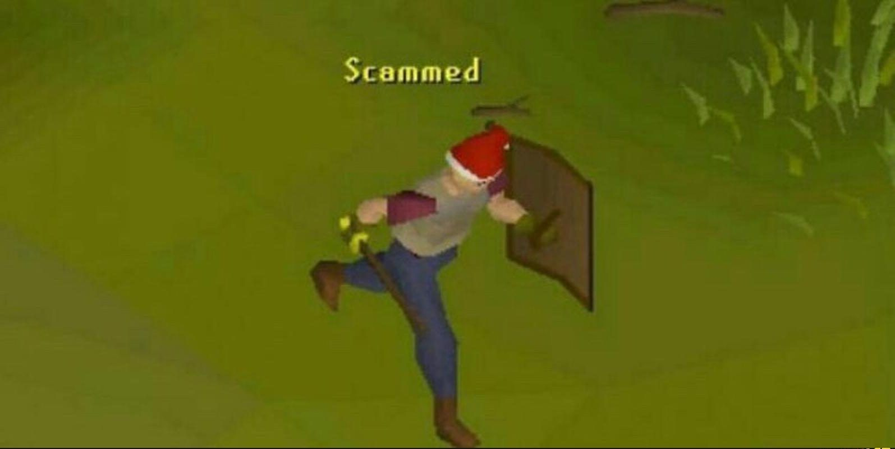
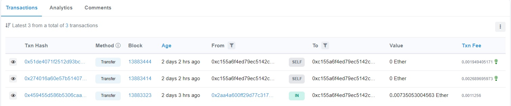

+++
title = "An opportunistic scammer"
description = "Scammed for only 30 dollars"
date = 2021-12-28

[extra]
tags = ["Scammed"]
read = "13 min"
+++

I've had various nicknames.
I've been liking this nickname, narigon enough to the point I'd like to make it my online persona.

Nicks usually go on a first-come first-serve basis. However, there's one service where I'd really love to have my nickname.
Quickly I found myself looking for the person who owned the nickname.
I started with Instagram, moved on to Facebook where I thought I had found the right person. Turns out I was wrong.

{{ chat(from=0, to=1) }}

A few weeks went by without them reading the message. Then on a fateful Monday evening:

{{ chat(from=1, to=4) }}

Turns out there's a language barrier. This made me think that the person genuinely owns the account, maybe they misunderstood my question due to said barrier?

From this point on, the messages will be translated using <abbr title="You can hover the Facebook messages to see the original untranslated text.">Google Translate</abbr>

I believe in human kindness. Statistically speaking, I think the percentage of people who would scam you in this situation is pretty low.
His real name in a way forms my nickname narigon. I think it's pretty unlikely that a person would use this chance to scam me? There's not many people who have the same nickname. Even fewer people contact a person on the internet asking to buy their account name.

{{ chat(from=4, to=11) }}

That seems reasonable! I'm happy that I'm working with such a professional. Happy to also help a person in need.

## The transaction

{{ chat(from=11, to=15) }}

Should've known better. I thought they don't have PayPal in the country they're from. Luckily I have around 50 dollars in Ethereum.

{{ chat(from=15, to=20) }}

At this point, around 30 minutes has passed. I start snooping around in their address to see if they're already trying to move the money.

Looks like they're pretty clueless. They have made two self transactions, presumably attempting to move the money somewhere else. They now only have around 10 dollars in their balance after all the network fees.

{{ chat(from=20, to=29) }}

Oh, what a turn of events. I've sent him "an ETH bug" 

I think if you're running these kind of scams, you should atleast have some competence in actually moving the money. Dude gained 10 dollars from an hour of work.

## The revelation

At this point, he seems to get pretty angry.

{{ chat(from=29, to=36) }}

Thanks for the advice.

{{ chat(from=36, to=39) }}

Looks like the money is gone. Wouldn't have thought that scammers can get this opportunistic.

Atleast I owned up to the nickname:

{{ chat(from=39, to=41) }}

Thank you for reading this dumpster fire, and have a good rest of your day.
